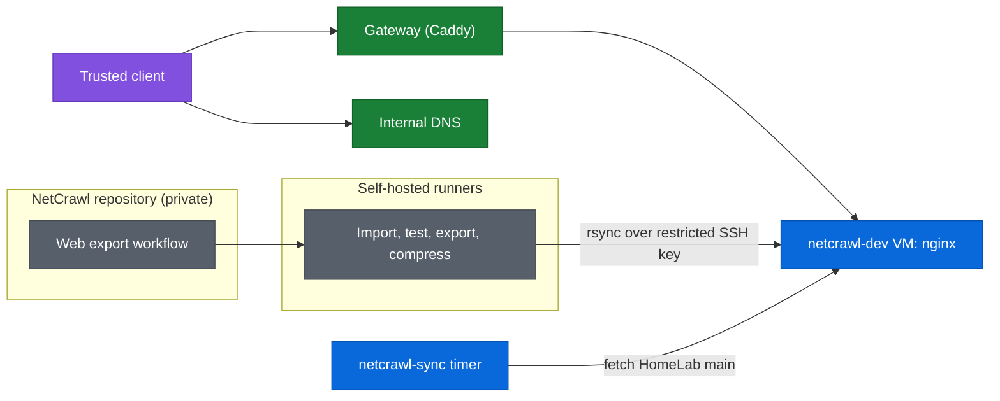
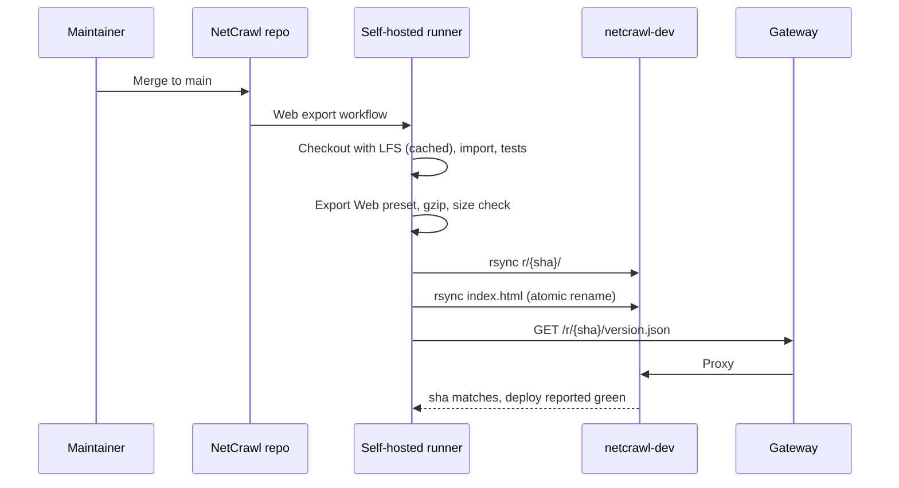

# NetCrawl web build hosting

**Status: planned.** This is the design for serving the browser build of [NetCrawl](https://github.com/krakenhavoc/netcrawl), a Godot 4.6 game, from the lab. Phase 1 is internal only: trusted LAN and VPN clients, through the private [gateway](gateway.md). Nothing here is deployed yet.

"NetCrawl" is a working name. The game is being renamed, so everything below that says `netcrawl` will change; [netcrawl/README.md](../netcrawl/README.md) lists what a rename touches.

NetCrawl's repository is private and this one is public. This page describes the hosting shape and the contract between the two repositories; game internals stay in the NetCrawl repository, and internal addresses stay out of this page as they do everywhere else in `docs/`.

## Goals

- Play the current `main` build in a browser on any trusted device, with a normal padlock and no plugin.
- Deliver a new build within minutes of a merge to NetCrawl `main`, without rebuilding a VM or editing this repository.
- Never serve a page that mixes files from two builds.
- Roll back by pointing at an earlier build, not by rebuilding one.
- Leave a short, deliberate path to public hosting later, without moving the game to a new name.

## Non-goals for phase 1

- Public access, accounts, or any server-side game logic. The build is static files; saves live in the player's browser.
- Mobile browsers and touch controls. Touch input is still planned in the game itself, so phase 1 targets desktop Chrome, Firefox, and Edge.
- Per-pull-request preview builds. The serving layout below makes them cheap later.

## Architecture



The gateway terminates TLS with the existing wildcard certificate and proxies one name to a small VM on the same VLAN as the gateway host. nginx on that VM serves immutable, versioned build directories. NetCrawl's CI builds the export on a self-hosted runner and pushes it straight to the VM. `netcrawl-sync` keeps the VM's nginx and Compose configuration in step with this repository and prunes old builds.

## Key decisions

| Decision | Choice | Consequence |
| --- | --- | --- |
| Reach | Gateway only, trusted networks and VPN | No new public ingress. VPN clients can already play. |
| Name | `niju-dev.labxp.io`, environment `dev` (was `netcrawl-dev`, which now redirects) | `niju.labxp.io` stays free for a public `prd` later, so phase 1 never needs a split-horizon override. Both are one label under the zone, which the edge certificate requires (see the `cmd-and-ctrl` deployment). |
| Placement | Dedicated VM, same VLAN as the gateway host | Same shape as `wkjp`. No inter-VLAN rule from the gateway. A stateless host can be replaced freely. |
| Origin | `nginx:alpine`, pinned | Matches `wkjp`. It only serves files; the gateway already does TLS. |
| Artifact delivery | CI pushes with `rsync` over a per-environment deploy key | No credential on the VM and no registry quota. See [Why push instead of an image](#why-push-instead-of-an-image). |
| Host configuration | `netcrawl/` in this repository, reconciled by `netcrawl-sync` | Same pull-and-validate loop as `wkjp` and `lastdash`. |
| Build layout | One directory per commit, root page redirects to the current one | A page load can only ever see one build. Rollback is one file. |
| Threads | Single-threaded web export | Works without cross-origin isolation and in more browsers. The headers are set anyway, so a threaded build later needs no infrastructure change. |

### Why push instead of an image

`lastdash` ships private images through GHCR and gives its VM a `read:packages` token. That works for a few hundred megabytes of application images that change occasionally. A NetCrawl web build measured 117 MB on the wire after the phase 0 fixes, and it changes on every merge. Private package storage and transfer are metered against the account's plan quota, so a few deploys a month could exhaust them. Pushing over the LAN costs nothing, keeps the VM free of a GitHub credential, and lets the workflow that built a release confirm it is being served.

The cost is an inbound SSH path from the runners to this VM. The key that uses it is limited to writing one directory (see [Delivery](#delivery)).

If the build turns out to be small, an image built by NetCrawl CI and pulled by `netcrawl-sync` is the fallback. It would be identical to `lastdash` and would need only `netcrawl/docker-compose.yaml` changes on this side.

## Ownership

| Piece | Owner |
| --- | --- |
| VM and first boot | `terraform/deployments/netcrawl` through `deploy.yaml` |
| HCP Terraform workspace `netcrawl-dev` | `terraform/deployments/tfc` |
| nginx, Compose, reconcile loop, release pruning | `netcrawl/` in this repository |
| TLS and private routing | `gateway/caddy/Caddyfile` |
| Portal entry | `gateway/homepage/services.yaml` |
| Runner registration for the NetCrawl repository | `terraform/deployments/gh-runner` |
| Web export preset, build, size budget, deploy step | NetCrawl repository |
| Internal DNS records, firewall rule from runners to the VM, static lease | Router and Pi-holes (not in Git) |

## The release contract

This is the interface between the two repositories. Either side can change freely behind it.

```text
/srv/netcrawl/www/
├── index.html             # redirect to the current release; written last
└── r/
    └── <git-sha>/         # one Godot web export, never modified after upload
        ├── index.html
        ├── index.js
        ├── index.wasm     (+ index.wasm.gz)
        ├── index.pck      (+ index.pck.gz when it saves >10%)
        ├── index.audio.worklet.js, icons, ...
        └── version.json   # {"sha", "ref", "built_at", "godot"}
```

NetCrawl CI is responsible for:

1. Uploading a complete `r/<sha>/` directory before touching anything else.
2. Then replacing the root `index.html`, a few lines that `location.replace()` to `r/<sha>/` with a `<meta refresh>` fallback. `rsync` writes it to a temporary name and renames it, so the switch is atomic.
3. Precompressing with `gzip -9 -k`. The gateway does not compress and the origin does not compress on the fly.
4. Failing the build when a release exceeds the size budget. The phase 1 budget is 150 MB on the wire; it is a NetCrawl workflow setting, not a host setting.

The host is responsible for:

1. Serving `r/**` as `Cache-Control: public, max-age=31536000, immutable` and the root `index.html` as `no-cache`.
2. Pruning: `netcrawl-sync` deletes all but the newest five releases, never the one the root page points at.
3. Answering `/healthz`.

Godot's export names its files `index.*` on every build, so without per-build directories a browser can hold a cached `index.pck` from one build next to a new `index.wasm` from another. Per-build directories with a single mutable pointer remove that class of failure, and make every recent build reachable by URL for comparison.

Saves are unaffected by the layout: Godot keeps `user://` in IndexedDB, which is scoped to the origin, not the path, so every release on `niju-dev.labxp.io` sees the same save slots.

## Serving

nginx on the VM, behind the gateway:

```nginx
server {
    listen 80;
    root /srv/netcrawl/www;
    absolute_redirect off;
    gzip_static on;

    # Cross-origin isolation. Only required by a threaded export, harmless
    # for a single-threaded one: the game loads nothing cross-origin.
    add_header Cross-Origin-Opener-Policy  "same-origin" always;
    add_header Cross-Origin-Embedder-Policy "require-corp" always;
    add_header Cross-Origin-Resource-Policy "same-origin" always;

    location = /healthz { access_log off; return 200 "ok\n"; }

    location = /index.html { add_header Cache-Control "no-cache" always; ... }
    location /r/ { add_header Cache-Control "public, max-age=31536000, immutable" always; ... }
}
```

The fragment shows intent; the real file lives at `netcrawl/nginx/default.conf`. Three nginx details:

- The stock `mime.types` in `nginx:alpine` already maps `.wasm` to `application/wasm`. Don't add a `types` block to fix it: inside `server` that replaces the whole map rather than extending it.
- `add_header` in a `location` replaces the server-level headers instead of adding to them, so the isolation headers have to be repeated (or included from a snippet) in every location that sets `Cache-Control`.
- Mount `/srv/netcrawl/www` as a directory, not individual files, for the same reason `wkjp` does: `rsync` replaces files, and a file bind mount keeps serving the old inode.

The gateway route is a plain proxy with no header rewriting:

```caddyfile
niju-dev.labxp.io {
	import tls_krakenkey
	reverse_proxy <static lease>:80
}
```

## Delivery



The runners are self-hosted for three reasons: they can reach the VM, the NetCrawl checkout carries several hundred megabytes of Git LFS objects that a persistent workspace downloads once instead of on every run, and the Godot editor plus export templates (pinned to the project's Godot version) are cached on the runner rather than fetched per job.

Runners register to a single repository, so NetCrawl needs its own registration in `gh-runner`, next to the existing `cmd_and_ctrl` one. One or two runners are enough; exports are serialized per branch and never cancelled mid-upload.

### The deploy key

Following the `cmd-and-ctrl` precedent, each environment has its own key pair. The private key is a secret in the NetCrawl repository's `dev` environment. The public key is not a secret, so it lives in this repository at `netcrawl/deploy/authorized_keys`, and `netcrawl-sync` installs it. Adding, rotating or revoking a key is a pull request, not a VM rebuild, and a rebuilt VM gets the current keys on its first sync. `netcrawl-sync` refuses the whole file if any line lacks the forced command below. On the VM it is authorized for a dedicated `deploy` user only, and forced through `rrsync`, which ships with Ubuntu's `rsync`:

```text
command="/usr/bin/rrsync -wo -no-del /srv/netcrawl/www",restrict ssh-ed25519 AAAA... netcrawl-dev-deploy
```

That key can write files under `www/` and nothing else: no shell, no forwarding, no reads, no deletes, and no access to the Compose project or nginx configuration. Deleting old releases is the host's job, not CI's. The host key is pinned in the workflow through a repository variable, never by `StrictHostKeyChecking=no`.

## Host

`terraform/deployments/netcrawl/`, environment `dev`. It's a raw Proxmox VM resource with a pinned MAC, the same shape as `wkjp`:

| Setting | Value | Why |
| --- | --- | --- |
| vCPU / memory | 1 / 1 GB | Static file serving. |
| OS disk | 20 GB | Five releases plus their `.gz` copies, images, and logs. |
| VLAN | Same as the gateway host | No inter-VLAN rule for the proxied path. |
| Address | Static DHCP lease for a pinned MAC | The next free entry in the lease sequence `lastdash` and `wkjp` use. The lease and the Caddyfile upstream change together. |
| Tags | `apps`, `dev` | |

Cloud-init installs Docker, creates the `deploy` user (with no key; see above), creates `/srv/netcrawl/www` owned by `deploy` and readable by the nginx container, clones this repository, and installs and starts `netcrawl-sync.timer`, as the `wkjp` template does. It holds no secrets, so `secrets.env` is not needed for this environment.

`netcrawl-sync` is a copy of `wkjp-sync` with two added steps: install the deploy keys, and prune releases. It deletes all but the newest five directories under `www/r/`, never the one the root page currently points at, and skips pruning entirely if it cannot parse that page.

## Prerequisites in the NetCrawl repository

These are game-side changes that must land before phase 1. They are listed here because hosting depends on them. The first four are in [netcrawl#49](https://github.com/krakenhavoc/netcrawl/pull/49).

Measured there with Godot 4.6.1, served through `netcrawl/nginx/` and loaded in headless Chromium: the pack went from 418 MB to 114 MB, which is 117 MB on the wire with the wasm gzipped. The title art, starter sprites and overworld rendered with no console errors, where `main` showed placeholder squares.

- **A committed Web export preset.** Single-threaded, no PWA, with export filters that exclude source art, generation prompts, design documents, and tests.
- **The Compatibility renderer.** Godot's web platform runs only the Compatibility (WebGL 2) renderer, so the project's mobile-renderer lighting and glow must be checked visually under it.
- **Loading art from the exported pack.** Several runtime loaders read source PNGs directly from `res://`. Export packs contain the imported textures, not the source files, so in any exported build those loaders fail and the game silently falls back to placeholder art. They need to load through the resource loader when running from an export.
- **A size budget the browser can hold.** Godot loads the whole pack into browser memory before the title screen. Sprite art is currently authored far above its on-screen size. Capping the import size of the largest sprite sets, where the game already scales them to fit, brought the download into the phase 1 budget (418 MB to 114 MB). Music stays in the main pack.
- **Browser-specific behavior.** Check web audio playback through the runtime buses. `Escape` leaves browser fullscreen before the game sees it. `F1` may open browser help.

## Rollout

| Phase | Work | Done when |
| --- | --- | --- |
| 0. Spike (NetCrawl) | Fix the art loaders, add the preset, export locally, serve with the same headers, and play through a battle and a save. Record the pack size. | A release plays end to end in a local browser and its size is known. |
| 1a. Host (this repo) | `tfc` workspace, `terraform/deployments/netcrawl`, `netcrawl/` runtime, gateway route, portal card. Lease, DNS records on both Pi-holes, and the firewall rule from the runners to the VM, by hand. | `https://netcrawl-dev.labxp.io/healthz` answers from a trusted client. |
| 1b. Delivery (both) | Runner registration, deploy key, NetCrawl web workflow. | A merge to NetCrawl `main` is playable at `netcrawl-dev.labxp.io` within ten minutes, and the workflow reports the served sha. |
| 1c. Verify | Rollback by rewriting the root page to the previous sha. Confirm the name does not resolve or answer from outside the lab. | Both proven once and noted here. |

## Later

- **Previews.** Any build can be uploaded as `r/<sha>/` without moving the root pointer, which gives pull-request previews with no new infrastructure. They share save slots with `main` because they share an origin. If save-format changes make that unsafe, previews move to their own name.
- **Off-LAN playtesters.** VPN first. If testers can't use the VPN, put the same origin behind a Cloudflare tunnel with an Access policy, the way `cmd-and-ctrl` reaches the internet.
- **Public.** A separate `prd` environment at `niju.labxp.io` behind a Cloudflare tunnel, using the `cmd-and-ctrl` tunnel and DNS resources. A cache rule for `r/*` is needed for the edge to cache them, because Cloudflare doesn't cache `.pck` or `.wasm` by default; the immutable headers make that rule safe. Promotion copies the exact `r/<sha>/` that `dev` served, then moves `prd`'s root pointer. It never rebuilds.
- **Monitoring.** nginx access logs to the existing Grafana stack, if usage ever makes that worth it.

## Open questions

- Do the runners reach this VLAN on SSH today, or does the router need a new rule?
- Which address the static lease for the new MAC gets. The gateway route assumes the next one in sequence.
- Battles, saving to IndexedDB, and audio in a real browser, which the phase 0 run did not exercise.
